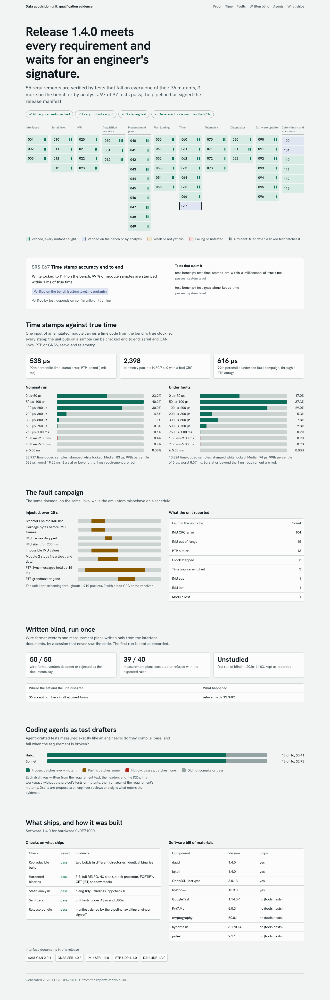

# instrumentation-qualification-kit

**Integration and qualification software for a flight-test data acquisition unit, from the interface control
document to signed release evidence, where every traceability link is proven by mutation.**

The unit acquires an IMU over RS-422, analog modules over CAN, GNSS time with a PPS edge and PTP over Ethernet,
validates the measurement plan the planning software sends before it touches the hardware, and streams
time-stamped telemetry. Around it sits what a qualification campaign needs: interface documents that generate
the code, emulators of every device so the simulation team and CI can test without hardware, requirements-based
tests, a traceability matrix in which a link counts only when a mutant proves it, a blind conformance set,
reproducible and signed releases with an SBOM, and a measured answer to where coding agents help.



## Results

Every number below is generated by `scripts/evidence.sh` into `reports/` and shown in the evidence console
([docs/TRACEABILITY.md](docs/TRACEABILITY.md) has the full matrix).

| | |
|---|---|
| **Release gate** | **pass**: 58 of 58 requirements verified; 97 of 97 tests pass; the manifest is signed by the pipeline and waits for an engineer's signature |
| **Mutation proof** | **76 of 76 mutants caught** by a test linked to their requirement; 51 testable requirements proven this way, 3 verified at system level on the bench, 4 by analysis or inspection |
| **Traceability links** | 113 requirement-test claims: 71 proven by a mutant the test catches, 18 unproven (the test passes but catches none of that requirement's mutants), 24 system level |
| **Time stamps, end to end** | locked to PTP over 30 s on the bench: median **83 µs**, 99th percentile **538 µs** from true time (requirement: 1 ms); 2,398 packets, 0 with a bad CRC |
| **Fault campaign** | bit errors, garbage, dropped and impossible IMU samples, a module dying, a 5 s PTP outage and 15 ms PTP jitter: the unit kept streaming (1,910 packets, 0 bad), logged each fault, failed over to GNSS and back; 99th percentile **616 µs** while locked |
| **Exact replay** | a recording of the daemon's inputs reproduces its telemetry byte for byte |
| **Blind conformance set** | written from the ICDs and the plan format only, run once: **50 of 50** wire-format vectors, **39 of 40** plans |
| **Agent-drafted tests** | 32 drafts (Haiku and Sonnet, 16 requirements each): 13 of 16 per model compiled, passed and caught **every** mutant; 0 hollow; Haiku $0.41 in total, Sonnet $2.73 |
| **Assurance** | two builds in different directories give identical binaries; PIE, full RELRO, NX, stack protector, FORTIFY and CET on both binaries; clang-tidy and cppcheck 0 findings; 85 unit tests pass under ASan and UBSan; CycloneDX SBOM |


## The problem this solves

A traceability matrix usually records that a test verifies a requirement because someone wrote it down.
Structural coverage does not close the gap: a test can execute every line and assert nothing the requirement
says. With coding agents drafting tests, hollow tests become cheap. Here a link counts only when it is proven:
each testable requirement carries **mutants**, the plausible ways to break it in the code (a byte order flipped,
a retry missing, a read-back skipped, a lock declared one measurement early), and a test's claim is evidence only
if the test fails on them ([ADR 2](docs/adr/0002-mutation-checked-traceability.md)).

## How it works

```
icd/*.yaml ──► iqk icd generate ──► cpp/gen (C++ codecs, config)  ──► unit software (C++20)
     │                          └─► docs/icd/*.md (the ICD people read)        │
     └──► Python codec (independent reading) ──► property tests: C++ == Python  │
                                                                                ▼
  SITL bench: IMU (pty) · GNSS + PPS · CAN modules (UDP) · PTP grandmaster ──► daud ──► telemetry recorder
                 fault injection by name and time; one true clock scores every time stamp
                                                                                │
requirements/srs.yaml ─┐                                                        ▼
qual/mutants.yaml ─────┼─► unit + system tests (claims) ─► mutation proof ─► traceability matrix ─► gate
heldout/ (written blind)┘                                                                          │
                     reproducible build · hardening · clang-tidy · cppcheck · ASan/UBSan · SBOM ───┤
                                                     release manifest (hashed CIs) ─► pipeline signs ─► engineer signs
```

| Area | What is here |
|---|---|
| **Interfaces** | Five ICDs (IMU-SER, AAM-CAN, GNSS-SER, PTP-UDP, DAU-UDP) as YAML; generated C++ codecs with exact lengths and ICD ranges in raw units; the readable ICDs in [docs/icd](docs/icd) ([ADR 1](docs/adr/0001-icd-as-single-source.md)) |
| **Drivers** | Serial framing that resynchronises after corruption and lost bytes; IMU stamped with acquisition time (running minimum of arrival minus device time); CANopen-style modules with heartbeats, per-group frame counters and over-range; deterministic state machines, no allocation on the acquisition path ([ADR 3](docs/adr/0003-deterministic-core.md)) |
| **Time** | IEEE 1588 two-step end-to-end slave, delay outlier filter, GNSS with PPS pairing, PI servo per source, slew under 1 ms, holdover and free-running, source failover with hold time ([ADR 5](docs/adr/0005-per-source-time-servo.md)) |
| **Planning software ↔ hardware** | A strict plan parser and 13 rules (rates, ranges, shared data frames, alarm limits inside what a channel can measure, worst-case CAN bus load with bit stuffing, telemetry link budget); a loader that acknowledges every register write, retries, reads every register back and checks each module's configuration CRC before arming ([docs/PLAN_FORMAT.md](docs/PLAN_FORMAT.md)) |
| **Diagnostics and update** | Built-in test, a bounded fault log that folds repeats, a status and fault-log protocol; signed A/B update (Ed25519 over the header, SHA-256 of the image), anti-rollback, trial boots, verified boot, power loss at any write |
| **SITL bench** | Emulators of every device on the link type the unit uses, fault injection, record and byte-exact replay ([iqk/bench.py](iqk/bench.py)) |
| **Qualification** | Requirements with the configuration values they cite; tests that declare what they verify; mutation proof; a generated [verification plan](docs/VERIFICATION_PLAN.md) and [traceability matrix](docs/TRACEABILITY.md); change impact by configuration key; a release manifest that hashes every configuration item and evidence file |
| **Assurance** | Reproducible build (two directories, identical binaries), hardening checked on the ELF (PIE, full RELRO, NX, stack protector, FORTIFY, CET), clang-tidy and cppcheck clean, ASan and UBSan, CycloneDX SBOM, CI on every push |
| **Agents** | Claude Code sessions draft tests per requirement in a sandbox without the project's tests or mutants; drafts are measured by mutation and stay proposals ([ADR 4](docs/adr/0004-agents-draft-engineers-sign.md)) |

## Run it

```bash
sudo apt-get install ninja-build libgtest-dev libssl-dev clang-tidy cppcheck
pip install pyyaml cryptography pytest hypothesis ruff
scripts/check.sh --system            # build, 85 unit tests, codec parity, the bench system tests
python3 -m iqk.cli bench --seconds 30 --fault ptp_outage@10-20     # the daemon against the emulators
./build/iqkctl validate examples/plans/ground_run.plan             # what the unit says about a plan
scripts/evidence.sh                  # every report: tests, mutants, assurance, matrix, signed release
cd web && npm ci && npm run dev      # the evidence console
```

## What building it found

- **A plan load that failed was never logged.** When a module's configuration CRC arrived wrong inside a
  response, the loader failed correctly but the unit's fault log stayed silent. A unit test caught it.
- **Mutants found weak tests that review had passed.** No test covered a frame cut short by lost UART bytes,
  or IMU samples held up behind module frames; both mutants survived until the tests were written. Five
  mutants were dead code the compiler rejected, and two were equivalent, because the generated decoders check
  the length twice; those now remove both checks.
- **An agent's failing draft found a real gap.** Haiku's draft for module supervision failed on the unit
  because it tested a module the plan uses that never sends a heartbeat, which the unit never reported. The
  fix and its test are ours; the draft stays a proposal. The other failures were the agents' own: two drafts
  rested on wrong assumptions (that the fault log holds nothing else; that a new image lands in slot A), and
  three were never built because the sandbox refused a compound shell command (`cd …; cat > file <<EOF … &&
  ninja`) and the session stopped instead of using the build command it was given.
- **The blind writer found a requirement that can never fire.** With a 2 Mbit/s telemetry link, any plan that
  passes the 60 % CAN-bus limit produces under 10 k samples/s, so the link-budget rule (PLN-12) cannot fail on
  its own. The writer also listed 34 ambiguities in the documents. The one plan the unit disagrees with
  concerns number syntax, an ambiguity the writer had flagged; the set is kept unstudied.
- **One servo could not serve two sources.** Gains tuned for PTP at 8 Hz never locked to GNSS once a second
  with a software-stamped PPS edge; the clock rate swung by up to 200 ppm. Gains and lock thresholds are now
  per source ([ADR 5](docs/adr/0005-per-source-time-servo.md)).
- **CI found what the laptop did not.** Builds were not reproducible across directories (the build path
  reached the binaries), a clang job needed an include gcc had pulled in for free, and clang's analyzer
  flagged an unchecked enum cast in the replay tool. An integer overflow in a test's loop counter had let
  `-O2` drop the loop bound; the sanitizer job exists so that never goes unseen again.


## Limits

- **No hardware.** Every device is an emulator: serial over pseudo-terminals, CAN encapsulated in UDP
  (a SocketCAN path is not exercised), the PPS line as a datagram. No hardware-in-the-loop campaign has run.
  The bench is built so the same scenarios can point at real ports, but that has not happened.
- **Software time stamps.** The unit stamps PTP and PPS in user space, so the lock thresholds are 100 µs (PTP)
  and 400 µs (GNSS); with kernel or NIC stamping they would be about 1 µs. Module samples are stamped on
  arrival, so the emulators' own scheduling shows up in the tail (worst stamp 19 ms off in the nominal run).
- **Not a certified process.** Nothing here claims DO-178C, ECSS or any assessor's approval. Mutation
  checking strengthens traceability; it does not replace structural coverage analysis or independence, and
  it only catches the violations someone wrote a mutant for (1 to 3 per requirement).
- **Security is modelled, not proven on a target.** Verified boot is a software model of a boot chain; the
  anti-rollback floor lives in a state file, where hardware would use a one-time-programmable counter; OS
  hardening stops at the binaries' flags.
- **During a source failover the unit reports quality 0** while it relocks (eight GNSS seconds), even though
  its clock is still disciplined; reporting holdover there would be more useful.
- **The blind set was written by a separate Claude session given only the documents, not by a person.** The
  agent experiment ran prompt version 1 once; 16 requirements is a small sample.

